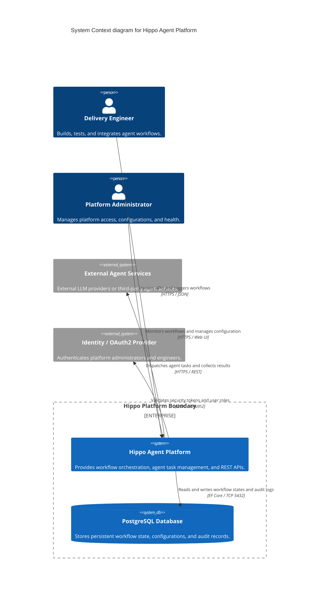

# Hippo Agent Platform — Architecture

## System Diagram



## Tech Stack

- **Runtime & Framework**: .NET 9 (C# 13), ASP.NET Core Web API.
- **Data Persistence**: PostgreSQL 16+, Entity Framework Core (EF Core 9).
- **Frontend / Portal**: ASP.NET Core Razor Pages / Blazor with GDS Design System components.
- **Testing**: xUnit, FluentAssertions, NSubstitute, Testcontainers for .NET, Playwright.
- **Containerization**: Linux-based Docker containers.
- **CI/CD**: GitHub Actions.

## Layers

The application applies Clean Architecture with strict inward dependency rules:

1. **Domain Layer**:
   - Contains core entities, value objects, domain events, and repository interfaces.
   - Zero dependencies on external frameworks, databases, or UI libraries.

2. **Application Layer**:
   - Contains use case orchestrators, command and query handlers (CQRS), input/output DTOs, and interface definitions.
   - Coordinates business tasks and enforces transactional consistency.

3. **Infrastructure Layer**:
   - Implements data persistence with EF Core, database migrations, and external service client adapters.
   - Handles physical data storage, external network calls, and identity integration.

4. **Presentation / API Layer**:
   - Contains ASP.NET Core endpoints, middleware (authentication, exception handling, rate limiting), and the administration web interface.

## Key Patterns

- **Clean Architecture**: Decouples domain rules from infrastructure and delivery mechanisms.
- **Repository and Unit of Work**: Encapsulates data access and atomic persistence boundaries.
- **Mediator / CQRS Pattern**: Separates read queries from mutating state commands.
- **Dependency Injection**: Microsoft Extensions Dependency Injection for loose coupling and interface resolution.
- **Outbox Pattern (Planned)**: Guarantees reliable event publishing for asynchronous downstream consumers.

## Source code layout

```text
src/
├── Hippo.Agents.Domain/            # Entities, value objects, domain logic, repository contracts
├── Hippo.Agents.Application/       # Commands, queries, handlers, DTOs, interfaces
├── Hippo.Agents.Infrastructure/    # EF Core DbContext, migrations, external service clients
├── Hippo.Agents.Presentation.Api/  # ASP.NET Core Web API, controllers/endpoints, middleware
└── Hippo.Agents.Presentation.Web/  # Administrative UI and dashboard portal
tests/
├── Hippo.Agents.Domain.Tests/      # Pure domain unit tests
├── Hippo.Agents.Application.Tests/ # Application logic and handler unit tests
├── Hippo.Agents.IntegrationTests/  # Integration tests using Testcontainers (PostgreSQL)
└── Hippo.Agents.EndToEndTests/     # Browser and API E2E tests using Playwright
```

## Data Flow

1. **Request Intake**: The client sends an authenticated HTTPS request to the Presentation API layer.
2. **Authentication & Validation**: Middleware verifies JWT security tokens and validates request payload structure.
3. **Application Dispatch**: The Presentation layer dispatches a Command or Query to the Application layer.
4. **Domain Execution**: The Application handler loads aggregate roots via repository interfaces and executes domain operations.
5. **Persistence**: The Infrastructure layer applies changes to the PostgreSQL database within an atomic transaction.
6. **Response Delivery**: The Application handler maps results to an output DTO and returns a structured response to the client.

## Cross-Cutting Concerns

- **Security**: JWT bearer token authentication, role-based authorization policies (RBAC), and HTTPS enforcement.
- **Observability**: Structured logging with Serilog, OpenTelemetry tracing, and OpenTelemetry metrics.
- **Health Checks**: Standard ASP.NET Core health check endpoints (`/health/ready`, `/health/live`).
- **Error Handling**: Global exception handling middleware that maps exceptions into standard RFC 7807 Problem Details payloads.

## ADRs

<!-- adr-table:start -->
| ID | Title | Status | Date |
|----|-------|--------|------|
| [ADR-0001](decisions/ADR-0001-clean-architecture.md) | Adoption of Clean Architecture Pattern | accepted | 2026-03-31 |
| [ADR-0002](decisions/ADR-0002-tech-stack-dotnet9-postgresql.md) | Technology Stack Selection (.NET 9 and PostgreSQL) | accepted | 2026-03-31 |
<!-- adr-table:end -->

## Assumptions

<!-- assumption-list:start -->
- [ASSUME-0001](assumptions/ASSUME-0001-cloud-container-hosting.md): Managed cloud container hosting environment (unresolved)
- [ASSUME-0002](assumptions/ASSUME-0002-desktop-browser-primary-device.md): Desktop and tablet browsers as primary user interface devices (unresolved)
- [ASSUME-0003](assumptions/ASSUME-0003-ci-docker-testcontainers.md): Docker daemon availability in CI runners for Testcontainers (unresolved)
- [ASSUME-0005](assumptions/ASSUME-0005-hello-world-value.md): Hello-world endpoint provides baseline connectivity value (unresolved)
- [ASSUME-0006](assumptions/ASSUME-0006-hello-world-route-and-message.md): Hello-world endpoint route and message payload (unresolved)
<!-- assumption-list:end -->

The save_adr and save_assumption tools fill these lists. Do not edit between the markers.
